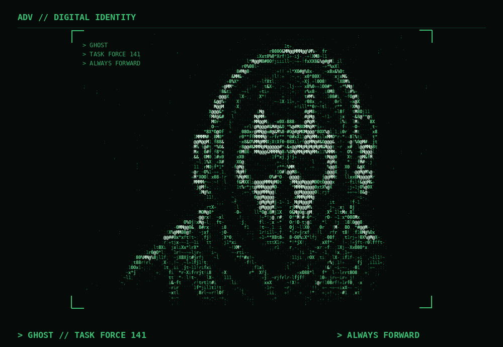
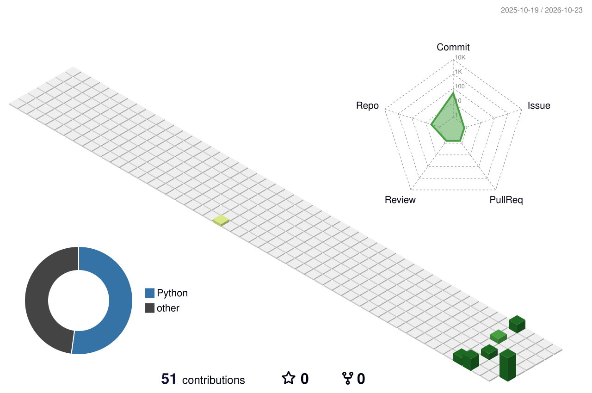

  # 🟢 adv1707 | ECE × AI/ML × Hardware

<div align="center">

  


<p align="center">
  
</p>

<h1 align="center">
  <span style="color:#00F5FF;">Aditya</span>
  <span style="color:#FF2BD6;">Kumar Verma</span>
</h1>

<p align="center">
  <samp style="color:#00F5FF;">[ ECE × AI/ML × HARDWARE ]</samp>
</p>


  <a href="https://github.com/adv1707">
    
  </a>

  <br/>


  <br/><br/>

  **Curiosity drives me. Code helps me build. Engineering keeps me exploring.**

</div>

---

## `$ whoami`

I'm an Electronics and Communication Engineering student interested in the intersection of **Artificial Intelligence, Machine Learning, and Hardware**.

I enjoy turning concepts into working projects, understanding the logic behind algorithms, and learning how software and hardware can work together.

- 🧠 Exploring Machine Learning and Deep Learning with Python.
- 🐍 Building projects using Python and its ML ecosystem.
- ⚡ Strengthening my Data Structures and Algorithms fundamentals.
- 🔬 Interested in AI acceleration,Deep Learning and LLMs ,computing systems, and hardware engineering.


> I believe in learning by building — one concept, one experiment, and one project at a time.

---

## ⚙️ Tech Stack

<div align="center">

### Languages & Development


### Machine Learning & Data Science


<br/>


</div>

**Currently focusing on:** Python, DSA, model building, data preprocessing, feature engineering, and evaluating ML models.

---


## 📊 GitHub Analytics

<div align="center">

  
  

  <br/><br/>

  

</div>

---

## 📈 Contribution Activity

<div align="center">

  

</div>

### 🧊 3D Contribution Graph

<div align="center">

  <picture>
    <source media="(prefers-color-scheme: dark)" srcset="./profile-3d-contrib/profile-night-green.svg"/>
    
  </picture>

</div>

*The 3D graph appears after you configure and run the GitHub Actions workflow described below.*


---

## ⏱️ Coding Activity

<!--START_SECTION:waka-->

```txt
From: 23 October 2026 - To: 30 October 2026

Python   7 hrs 8 mins          ███████████████████████▓░   95.27 %
CSV      13 mins               ▓░░░░░░░░░░░░░░░░░░░░░░░░   03.07 %
TOML     7 mins                ▒░░░░░░░░░░░░░░░░░░░░░░░░   01.66 %
```

<!--END_SECTION:waka-->

---


## 🎯 Current Focus

- [x] Build machine learning projects with Python.
- [x] Develop and deploy an interactive ML application.
- [ ] Strengthen DSA and problem-solving skills.
- [ ] Explore Deep Learning with PyTorch.
- [ ] Learn more about AI hardware and accelerated computing.
- [ ] Build projects that combine ECE and AI/ML.

---

## 🤝 Connect With Me

<div align="center">

  <a href="https://github.com/adv1707">
    
  </a>
<a href="https://www.instagram.com/adityav_3423/">
    
</a>

  <!-- Add your LinkedIn profile when ready -->
  <!--
  <a href="YOUR_LINKEDIN_URL">
    
  </a>
  -->

</div>

<div align="center">

  ### 💚 Build. Learn. Repeat.

  *The goal is not just to write code, but to understand what happens beneath it.*

  

</div>


